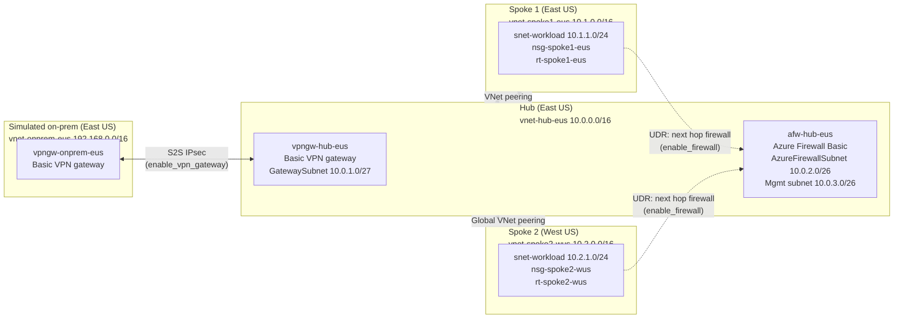

# AZ-104 Portfolio Lab: Secure Hub-and-Spoke Network in Terraform

A multi-region hub-and-spoke network on Azure, built entirely in Terraform, with a simulated on-prem site over site-to-site VPN and Azure Firewall inspecting traffic between spokes.

**Focus:** cost optimization (FinOps) inside the Azure Well-Architected Framework, with security and operational performance second. Every billable resource sits behind an on/off switch, so the free core costs $0 and the expensive parts only run for minutes.

Built across 13 recorded sessions. Logs are in [`dev-diary/`](dev-diary/).

---

## Architecture



The spokes are not peered to each other. With the firewall switched on, the only path between them runs through the firewall, and spoke internet traffic is blocked by default.

---

## What's in it

| Layer | Resources |
|---|---|
| Hub | `rg-lab-hub-eus`, `vnet-hub-eus`, GatewaySubnet, AzureFirewallSubnet, AzureFirewallManagementSubnet |
| Spokes | `rg-lab-spoke1-eus` (East US) and `rg-lab-spoke2-wus` (West US), each with a VNet and `snet-workload` |
| Peering | Hub to each spoke, both directions, forwarded traffic allowed |
| Security | NSG per workload subnet: `Allow-SSH-From-Hub` (TCP 22 from 10.0.0.0/16, priority 100) |
| Hybrid (toggle) | Basic VPN gateways in hub and on-prem, two local network gateways, IPsec connections both ways, shared key passed as a sensitive variable |
| Firewall (toggle) | Azure Firewall Basic, Basic firewall policy, rule `allow-spoke-to-spoke`, route tables sending spoke traffic (other spoke and 0.0.0.0/0) to the firewall's private IP, BGP propagation off |

Naming: `rg-lab-<role>-<region>`, `vnet-<role>-<region>`.

---

## The on/off switches

| Switch | Default | Resources to add | What it turns on |
|---|---|---|---|
| none | — | 22 | Free core: resource groups, VNets, subnets, peerings, NSGs |
| `enable_vpn_gateway=true` | false | +8 | VPN gateways, public IPs, local network gateways, IPsec connections |
| `enable_firewall=true` | false | +9 | Firewall, its two public IPs, policy, rule group, route tables and links |

```powershell
terraform plan                                  # free core, 22 to add
terraform apply -var="enable_firewall=true"     # core plus firewall
terraform destroy
```

---

## Cost summary

Every session ended with `terraform destroy` and a check that All resources showed only Network Watchers (free).

| Sessions | What ran | Cost |
|---|---|---|
| 1–9 | Resource groups, VNets, subnets, peering, NSGs | $0 |
| 10 | Hub Basic VPN gateway, briefly | a few cents |
| 11 | Two Basic VPN gateways and S2S connection | about 10 cents |
| 12 | Azure Firewall Basic | well under $1 |
| 13 | Firewall plus route tables | well under $1 |
| **Total** | | **under $3** |

These are list-price estimates, not billing data. Guardrails: monthly budgets of $20 and $10 on the subscription.

**FinOps choices that kept it cheap**
- Billable resources gated behind `count` toggles that default to off
- Basic tiers for VPN gateway and firewall (cheapest SKUs that can still be created)
- Build, verify in the portal, destroy in the same session
- No VMs; verification done through plan counts and portal checks

---

## Design decisions

- **No gateway transit.** On-prem reaches the hub only, not the spokes. Adding it is a known next step.
- **Firewall IP read from Terraform**, never hard-coded in the route tables.
- **Route tables live in the same region as their subnet**, so Spoke 2's table is in West US.
- **Secrets stay out of the repo.** The subscription ID comes from `ARM_SUBSCRIPTION_ID` and the VPN key from `TF_VAR_vpn_shared_key`. `terraform.tfstate` is gitignored.

## What I'd add next

- Test VMs to prove spoke-to-spoke traffic end to end through the firewall
- Gateway transit and on-prem traffic through the firewall
- Remote state in a storage account
- Azure Bastion instead of SSH from the hub

## Run it yourself

```powershell
az login
$env:ARM_SUBSCRIPTION_ID = (az account show --query id -o tsv)
terraform init
terraform plan
terraform apply
terraform destroy
```

Command reference: [`commands.md`](commands.md)
